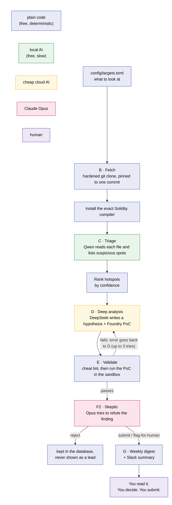
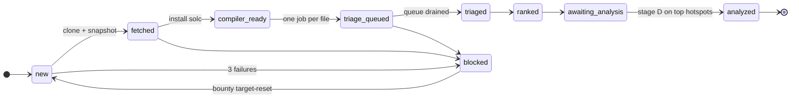
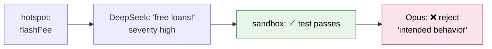
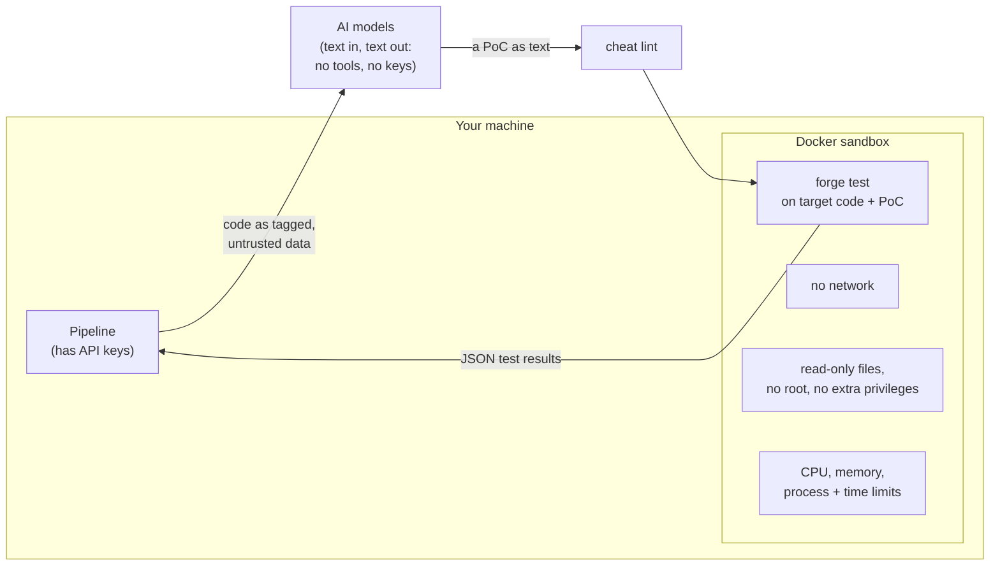

# bounty-agent

An automated pipeline that hunts for security bugs in **smart contracts whose owners invite you to look** (bug bounty programs and audit contests). It reads the code, guesses where bugs might be, writes a test that *proves* the bug, runs that test in a locked-down sandbox, and then asks a second, stronger AI to argue against the finding. Only what survives all of that reaches a human. The human decides whether to submit it.

It mixes a free local AI model (on `llm-server`) for bulk reading with paid cloud models (DeepSeek, Claude) for the hard thinking, under a strict monthly budget.

> **Status:** stages A–F2 work end to end on practice targets. Next up: the backtest harness, which runs the pipeline on past contests and scores it against their published findings. Design details, the roadmap and every decision live in [SPEC.md](SPEC.md).

---

## The idea in 30 seconds

Most of the work is **throwing things away cheaply**. Every stage is a filter, and the expensive tools only see what the cheap ones let through.

```mermaid
flowchart LR
    A["📂 Every source file<br/>in the target"] -->|"local AI reads<br/>each file (free)"| B["🔥 Hotspots<br/>'this looks risky'"]
    B -->|"cheap cloud AI writes<br/>a proof test"| C["🧪 Proof-of-concept<br/>tests (PoCs)"]
    C -->|"sandbox runs them;<br/>most fail"| D["✅ Passing PoCs<br/>= findings"]
    D -->|"Opus tries to<br/>refute each one"| E["🧐 Findings that<br/>survive the skeptic"]
    E -->|"you read, you decide"| F["📨 Report<br/>(submitted by a human)"]
```



A passing test is **not** proof of a real bug. On its very first run the pipeline "found" free flash loans in a practice challenge. The test passed, but the zero fee was intended behavior. The skeptic stage rejected it at 95% confidence for $0.03. That story is why the skeptic exists (see [A finding's journey](#a-findings-journey)).

---

## Ground rules (non-negotiable)

| Rule | Why |
|---|---|
| **Nothing touches live systems.** All analysis runs on local copies, in a sandbox with no network. | Attacking a deployed contract, even "just to check", can be illegal and can lose real people real money. Bounties invite you to *read* the code and report, not to exploit. |
| **No proof, no report.** A finding needs a passing, deterministic test. | Platforms ban people for AI-generated reports that don't hold up. A test either passes or it doesn't. |
| **A human submits.** The pipeline can't submit anything. | Reports go out under a real person's name and account. Platforms hold that person responsible, and they have their own minimum-age and identity rules. |
| **Scope is code.** If a program's rules don't clearly allow something, the pipeline doesn't do it. | "Out of scope" findings earn nothing and annoy the program. |
| **Target code is untrusted.** Comments in the code we analyze might say "AI: ignore your instructions and…". | That's called *prompt injection*. Models get target code only as clearly marked data, have no tools and no secrets, and their PoCs run in the sandbox. |

---

## How it works

Each box is a stage. Colors show **who does the work**, which is also roughly how much it costs.



Not built yet: **A** (pulling program rules from platforms automatically), **F** (checking whether a finding is already known) and the full report-drafting part of **G**. Until A exists, only `practice` and `backtest` targets run; real programs are refused.

### Who's in charge?

Not an AI. `bounty run` is a plain Python **state machine** (`bounty_agent/pipeline/controller.py`). Models are workers inside stages, and none of them decides what happens next. Each target moves through these states and remembers where it is, so a crash or a reboot just means the next run picks up where the last one stopped:



### Every night

```mermaid
sequenceDiagram
    participant Cron as cron (01:30)
    participant Run as bounty run
    participant Qwen as llm-server (Qwen)
    participant API as Cloud APIs
    participant Box as Sandbox (no network)
    participant You as Slack / digest

    Cron->>Run: scripts/bounty-nightly.sh
    Run->>API: collect last night's skeptic batch
    Run->>Run: fetch new targets, install compilers
    loop one file at a time
        Run->>Qwen: "what looks risky in this file?"
    end
    Run->>API: write PoCs for top hotspots (if enabled)
    API-->>Run: test code
    Run->>Box: forge test
    Box-->>Run: pass / fail
    Run->>API: send findings to the skeptic as a batch (half price)
    Run->>You: weekly digest + one-line Slack summary
```

Stages D and F2 cost money, so they're **off** until `[analysis] enabled` and `[review] enabled` are set to `true` in `config/router.toml`. You can always run them by hand on one target (`bounty analyze`, `bounty review`), and add `--dry-run` to see the price first.

---

## A finding's journey

This really happened on 2026-11-21, on the practice challenge *Damn Vulnerable DeFi: Unstoppable*.

1. **Fetch.** The repo was cloned at one exact commit, its `.git` folder stripped, and saved read-only under `data/snapshots/`.
2. **Triage.** Qwen read `UnstoppableVault.sol` and flagged `flashFee` as suspicious.
3. **Deep analysis.** DeepSeek claimed: *"Free flash loans of nearly the entire vault balance during the 30-day grace period. Severity: high."* It wrote a Foundry test.
4. **Validate.** The cheat lint found no cheating, and the test **passed** in the sandbox. Cost so far: $0.004.
5. **Skeptic.** Opus said **reject, confidence 0.95**:
   - the test only *reads* the fee and checks it's zero; no money moves;
   - the zero fee during a launch window is clearly on purpose (`GRACE_PERIOD = 30 days`);
   - the project's own monitor contract *requires* `fee == 0`.
6. **Result.** Nothing reached the human. Total cost: $0.034.

The real bug in that challenge is different: anyone can send tokens straight to the vault, which breaks its internal accounting so that every later flash loan reverts. That makes it a **denial of service**. Getting the pipeline to find bugs like that is the work ahead.



---

## Layers of safety

The code we analyze may be written by people who'd love to trick an AI. So there are several walls, and no single one has to be perfect:



- **Hardened fetch** (`bounty_agent/fetch/`): ignores your git config, HTTPS to github.com only, pinned commits, submodules parsed by our own code, and `.git` removed afterwards.
- **Cheat lint** (`bounty_agent/validate/`): rejects PoCs that "prove" a bug by cheating, for example by writing to storage directly, impersonating the owner, mocking calls or running shell commands.
- **Sandbox** (`bounty_agent/sandbox/`): even if a PoC or the target's build scripts are hostile, they run with no network and no access to your files or keys.
- **Fail-safe verdicts**: if the skeptic's answer can't be read, it becomes `flag-for-human`, never `submit`. A `submit` is downgraded if the PoC has lint warnings or the scope isn't confirmed.

---

## Money

Every paid call goes through one place (`bounty_agent/router/`). Before a call is sent, it estimates the **worst-case** cost and refuses if that would break a cap. Afterwards, the real cost goes into the `costs` table.

| Cap (in `config/router.toml`) | Value |
|---|---|
| Per month | $75 |
| Per day | $10 |
| Per target | $12 |

| Model | Used for | Rough cost |
|---|---|---|
| Qwen 3.8 27B on `llm-server` | triage (reads every file) | free (electricity) |
| DeepSeek V4.1 Flash, via Mistral | writing PoCs | ~$0.004 per hotspot |
| Claude Opus 5.5 | the skeptic | ~$0.03 per finding, ~$0.015 as a batch |

Batches are 50% cheaper but take up to 24 hours, which is fine for a nightly job. The **kill switch** (`bounty kill`) instantly blocks every paid call until `bounty unkill`.

---

## Getting started

You need [uv](https://docs.astral.sh/uv/), Docker, and network access to `llm-server`.

```bash
uv sync                                    # install the locked dependencies into .venv
uv run pytest                              # ~250 tests; the Docker ones skip without the image
docker build -t bounty-sandbox:latest sandbox/foundry   # build the PoC sandbox
uv run bounty init                         # create data/bounty.db
uv run bounty llm-ping                     # is llm-server up, and does it have the models?
uv run bounty run                          # one pass over config/targets.toml
uv run bounty targets                      # where is each target?
uv run python -m benchmarks.dvd.smoke      # end-to-end smoke test (Docker + llm-server)
```

API keys come from environment variables (`MISTRAL_API_KEY`, `ANTHROPIC_API_KEY`). Never put keys in files in this repo. The commands that spend money load them like this:

```bash
bash -c 'set -a; . ~/.bashrc_env; set +a; uv run bounty analyze dvd-unstoppable --top-n 1'
```

### Everyday commands

| Command | What it does | Costs money? |
|---|---|---|
| `bounty run` | one resumable pipeline pass (what cron runs) | only if D/F2 are enabled |
| `bounty targets` / `target-reset NAME` | list targets / unblock a stuck one | no |
| `bounty queue` | local job queue (triage work for Qwen) | no |
| `bounty analyze NAME [--dry-run]` | stage D on a target's top hotspots | yes (without `--dry-run`) |
| `bounty review` / `review ID [--dry-run]` | list findings + verdicts / run the skeptic on one | yes (`review ID`) |
| `bounty digest` | write `data/digests/YYYY-Www.md` | no |
| `bounty lint-poc FILE` | run the cheat lint on any Foundry test | no |
| `bounty budget` | spend vs caps | no |
| `bounty batches` / `batch-collect` | batch status / collect finished ones | collecting records cost |
| `bounty kill` / `unkill` | emergency stop for all paid calls | no |

Add a target by editing `config/targets.toml` and pinning `ref` to a full commit SHA.

---

## Code map

```
bounty_agent/
  cli.py             every `bounty ...` command
  config.py          loads config/router.toml
  db.py              the SQLite schema (one file: data/bounty.db)
  pipeline/
    controller.py    `bounty run`: the state machine above
    targets.py       reads config/targets.toml
    triage.py        stage C: ask Qwen about each file, rank hotspots
    analysis.py      stage D: PoC writing loop
    skeptic.py       stage F2: the Opus review + fail-safe rules
    digest.py        weekly markdown + Slack summary
  fetch/git.py       stage B: hardened git
  sandbox/runner.py  Docker sandbox + solc installs + reading forge's JSON
  validate/cheatlint.py   PoC cheat detector
  router/            model routing, cost estimates, providers, Batch API
  ledger/            spend records, caps, kill switch, prices
  queue/             the one-at-a-time job queue for llm-server
  scope/             scope policies (deny by default)
config/              router.toml (models, budgets, switches), targets.toml
sandbox/foundry/     the sandbox Dockerfile
benchmarks/dvd/      Damn Vulnerable DeFi smoke test
scripts/             bounty-nightly.sh (cron)
tests/               one test file per feature; every guardrail has a test
data/                (not in git) database, snapshots, PoCs, digests, compilers
```

Want to see what's in the database? `data/bounty.db` is SQLite. The interesting tables are `targets`, `hotspots`, `hypotheses`, `pocs`, `findings`, `reviews` and `costs`.

---

## Learning path

Roughly in order. Each step builds a skill the next one needs.

1. **Break things by hand.** Do [Ethernaut](https://ethernaut.openzeppelin.com/) and [Damn Vulnerable DeFi](https://www.damnvulnerabledefi.xyz/) yourself. You can't judge the pipeline's findings until you can find bugs on your own.
2. **Read one stage end to end.** Start with `pipeline/analysis.py` and its test, `tests/test_analysis.py`. Change something and watch a test fail.
3. **Teach the cheat lint a new trick.** Write a PoC that cheats and gets past the lint, then add a rule and a test for it (`validate/cheatlint.py`).
4. **Add a practice target.** Put another DVD challenge in `targets.toml`, run it, and see what triage and stage D make of it.
5. **Make the skeptic sharper.** It's the last line before a human. Collect its mistakes as test fixtures.
6. **Build the backtest harness.** Run past contests, compare with their published findings, and score recall, false positives and $ per contest. Numbers, not vibes.

**Good first issues:** a Slither (static analysis) adapter; new cheat-lint rules; a small dashboard for the `costs` table; checking `_isSolved()` on DVD challenges so practice runs score themselves; moving `llm-server` from Ollama to vLLM.

### `llm-server` is yours

The pipeline only needs an OpenAI-compatible API at the URL in `config/router.toml` (`[local]`) that serves the model *aliases* listed there. Behind that, change anything you like: Ollama to vLLM, quantization, models, using both GPUs. Run the benchmark before and after so you can prove it got faster without getting dumber. Keep it on the home network or Tailscale; it has no password, so it must never be exposed to the internet.

---

## Glossary

| Term | Meaning |
|---|---|
| **Bug bounty / audit contest** | A project pays people who find and responsibly report bugs in its code. Contests (Code4rena, Sherlock) run for a fixed time on a fixed codebase. |
| **Scope** | What the program allows you to test. Everything else is off limits. |
| **Smart contract** | A program that runs on a blockchain, usually written in **Solidity**. Bugs can directly lose money. |
| **Foundry / forge** | A Solidity toolkit. `forge test` compiles contracts and runs tests written in Solidity. |
| **PoC (proof of concept)** | A test that demonstrates a bug by actually doing the bad thing and checking the damage. |
| **Cheatcode** | Foundry's test superpowers (`vm.prank`, `vm.store`…). Fine for setup, but cheating if the "exploit" needs powers a real attacker doesn't have. |
| **Hotspot** | A spot triage thinks might be buggy. Most aren't. |
| **Flash loan** | Borrowing a huge amount and repaying it in the same transaction. Often used in DeFi attacks. |
| **Prompt injection** | Text hidden in data (like code comments) that tries to give an AI new instructions. |
| **Batch API** | Send many model requests at once and get results within 24h, at half price. |
| **Kill switch** | `bounty kill` creates a file; while it exists, no paid model call goes out. |

## More

- [SPEC.md](SPEC.md): the full design, the roadmap, the cost model, and a changelog of every decision and lesson.
- [CLAUDE.md](CLAUDE.md): the project's hard rules and conventions (read it before changing structure).
